# Forge

**Forge** is an offline-first Android fitness tracker for gym training, weight, steps and nutrition, with a Wear OS companion app. Everything is stored locally on your device. No account, no cloud, no ads.

<p align="center">
  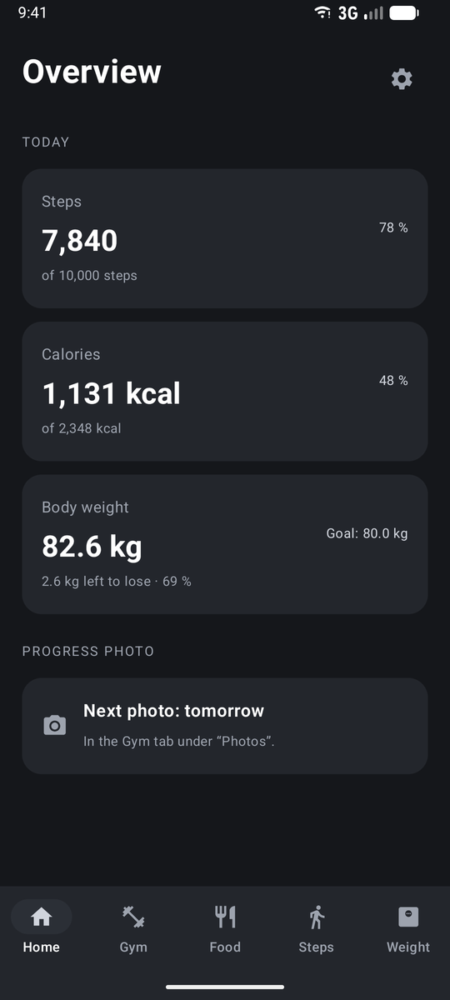
  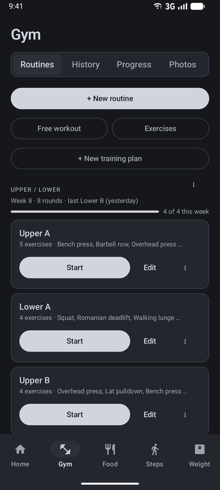
  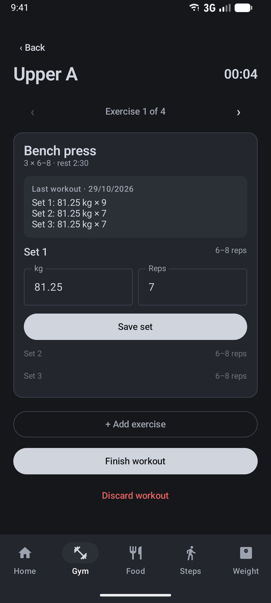
  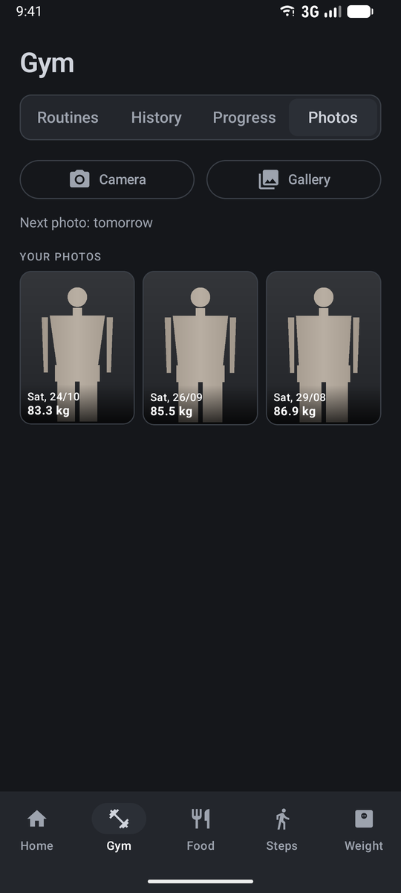
</p>

> Available in **English** and **German**. Forge follows your phone's language, or you can pick one under **Settings → Language**.
>
> The screenshots show demo data. The progress photos are placeholder silhouettes.

## Contents

- [Features](#features)
  - [Gym](#gym)
  - [Progress photos](#progress-photos)
  - [Weight](#weight)
  - [Nutrition](#nutrition)
  - [Steps](#steps)
  - [Wear OS companion](#wear-os-companion)
  - [Settings and data export](#settings-and-data-export)
- [Installation](#installation)
- [Building from source](#building-from-source)
- [Tech stack](#tech-stack)
- [Project structure](#project-structure)
- [Permissions](#permissions)
- [Privacy](#privacy)

## Features

### Gym

<p align="center">
  
  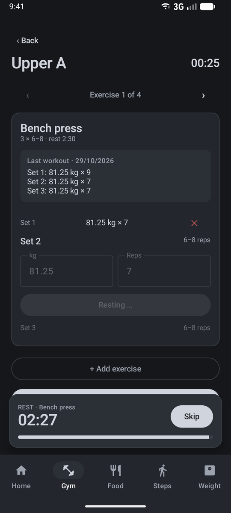
  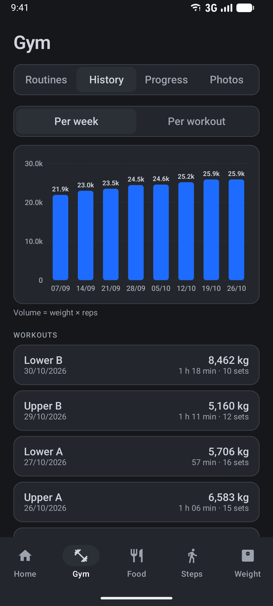
  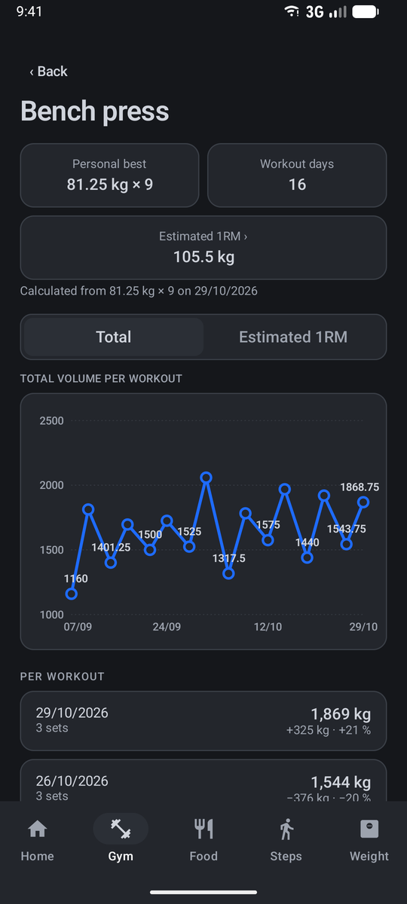
</p>

- **Exercise library** with muscle groups and three exercise types: reps, time (e.g. plank) and assisted (e.g. assisted dips)
- **Routines** with planned sets, rep ranges, rest times, unilateral exercises and supersets
- **Training plans** that group routines (e.g. *Upper A*, *Lower A*, *Upper B* and *Lower B* belong to *Upper / Lower*), in your own order
- **Plan progress:** current week, completed rounds, your last workout and how many of the plan's routines you've done this week
- **Duplicate plans** as a template, optionally as a deload (one set less per exercise)
- **Archive** routines and plans without losing any history, and restore them at any time
- **Live workouts** that show what you did last time and suggest when to add weight
- **Rest timer** with a notification, sound and vibration, even with the screen locked
- **Estimated 1RM** (Epley formula) per exercise, with a chart, a percentage table and a "new record" hint during your workout
- **History and progress:** volume per week and per workout, personal bests and a chart for every exercise

### Progress photos

<p align="center">
  
  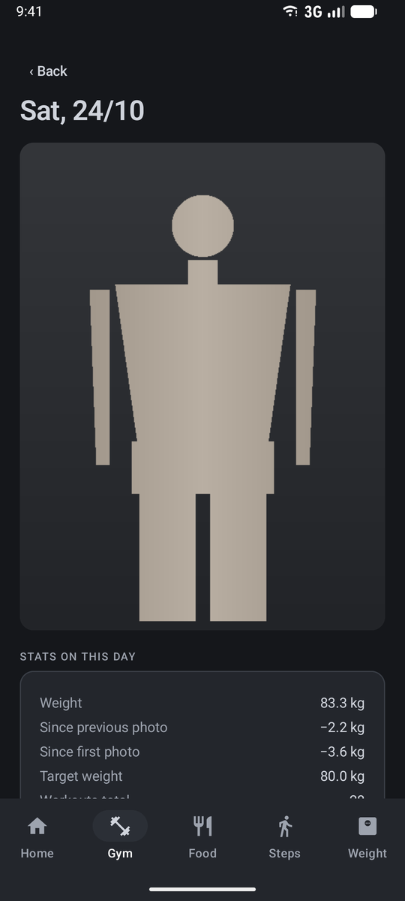
  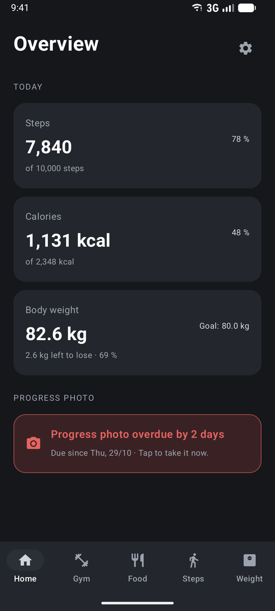
  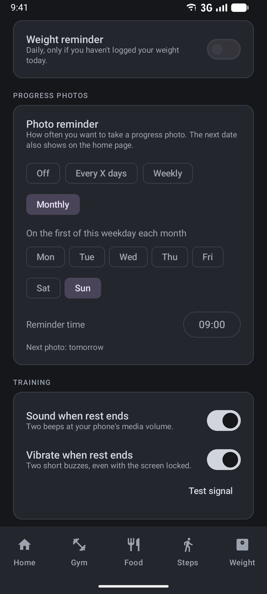
</p>

- **Camera or gallery:** take a photo right away or pick one you already have, in the Gym tab under **Photos**
- **Your stats are saved with every photo:** date and weight, plus goal weight, workouts (total and last 30 days), average steps and calories over the last 7 days, and your calorie target
- **Weight first:** if you haven't logged your weight today, Forge asks for it before the photo, so every photo has a weight
- **Compare:** open a photo to see it full size with its stats and how much your weight changed since the previous and the first photo
- **Reminders:** every X days, weekly on a weekday, or on the first weekday of each month (e.g. the first Sunday), with a notification at the time you choose
- **On the home page:** the next date is shown at the bottom, and the card turns light red when a photo is overdue
- Photos are downscaled and stored privately inside the app, without location data

### Weight

<p align="center">
  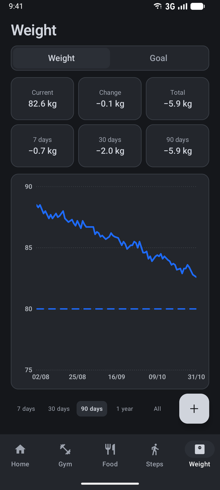
</p>

- Daily weigh-ins with a goal weight, a target date and a forecast
- Chart with 7-day, 30-day, 90-day, 1-year and all-time views. **Swipe left and right** to move through time
- Daily reminder at a time you choose, sent only if you haven't logged your weight yet

### Nutrition

<p align="center">
  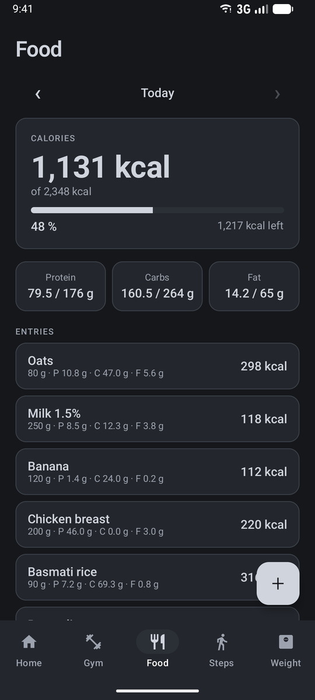
</p>

- Food database with portions (e.g. *1 slice = 40 g*) and meals made of several ingredients
- Food diary with calories, protein, carbs and fat for every day
- Calorie target calculated from your profile (height, age, sex, activity level and macro split) and your weight goal

### Steps

- Background step counting with the phone's hardware step counter, with correct handling of reboots and midnight
- Daily goal and a bar chart (7 or 30 days) that you can swipe through

### Wear OS companion

A companion app for your watch (e.g. Galaxy Watch) that shows what's happening on your phone. All input stays on the phone.

- **Workout on your wrist:** opens automatically when you start a workout on the phone, and shows the current exercise, set, target reps, your last performance and new 1RM records
- **Rest timer** with a progress ring that vibrates on your wrist when the rest is over. **+30 s** and **skip** are the only buttons on the watch
- **Ongoing activity:** an icon on the watch face takes you back to the workout at any time
- **Home screen and tile** with today's steps, calories eaten versus your daily target, and your weight
- **Complication** that shows today's steps on your watch face
- Uses the same language as the phone app

### Settings and data export

<p align="center">
  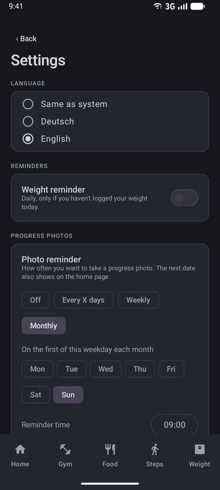
</p>

- **Language:** same as system, English or German
- **Reminders** for your weight and your progress photos
- **Rest signal:** sound and vibration when a rest is over, each can be turned off
- **Calorie profile** and a step counter check that shows why steps might be missing

Export all your data as a ZIP file of CSV tables under **Settings → Data → Export**. File and column names are German in both languages, so your scripts keep working:

| File | Contents |
|---|---|
| `tage.csv` | One row per day: weight, steps, calories, macros, workouts, sets, volume |
| `gewicht.csv` | All weigh-ins |
| `schritte.csv` | Steps per day |
| `ernaehrung.csv` | Every food diary entry with nutrients |
| `training_einheiten.csv` | Every finished workout with plan, duration and volume |
| `training_saetze.csv` | Every logged set |
| `LIESMICH.txt` | Description of all files |

The files are standard CSV (UTF-8, comma-separated, dot as decimal separator, ISO dates), so Excel, Google Sheets, Python and R can read them directly:

```python
import pandas as pd
days = pd.read_csv("tage.csv", parse_dates=["datum"])
```

## Installation

1. Download `forge-1.2.0.apk` from the [latest release](https://github.com/ItsDylan255/Forge/releases/latest).
2. Open it on your Android phone and allow installing apps from this source.

Requires **Android 8.0 (API 26)** or newer. New versions install over the old one and keep your data.

### Watch app (optional)

Requires **Wear OS 3** or newer (e.g. Galaxy Watch 4 and later). The watch app isn't on the Play Store, so you install `forge-watch-1.2.0.apk` from the release over Wi-Fi debugging:

1. On the watch, enable developer options: **Settings → About watch → Software**, tap **Software version** 7 times.
2. Under **Settings → Developer options**, turn on **ADB debugging** and **Wireless debugging**, then tap **Pair new device**.
3. On your computer (watch and computer on the same Wi-Fi):
   ```bash
   adb pair <ip>:<pairing-port>     # code shown on the watch
   adb connect <ip>:<port>          # address shown under Wireless debugging
   adb install forge-watch-1.2.0.apk   # from the latest release
   ```

Phone and watch app must be signed with the same key, otherwise they can't talk to each other.

## Building from source

Requirements: Android Studio (or the Android SDK) and JDK 17+.

```bash
git clone https://github.com/ItsDylan255/Forge.git
cd Forge
./gradlew assembleDebug        # phone APK in app/build/outputs/apk/debug/, watch APK in wear/build/outputs/apk/debug/
./gradlew testDebugUnitTest    # unit tests
```

## Tech stack

- Kotlin, Jetpack Compose, Material 3
- Room (SQLite) with versioned migrations
- WorkManager for reminders, foreground services for workouts and step counting
- Charts drawn with Compose Canvas, no chart library
- Watch: Compose for Wear OS, Tiles, Complications, Ongoing Activities and the Wearable Data Layer

## Project structure

```
app/src/main/java/com/example/fitnesstracker/
├── data/       Room entities, DAOs, repositories, preferences, export, photo storage
├── i18n/       App language (English/German) and the tr() helper
├── domain/     Pure Kotlin logic (calculations, parsing, formatting, reminders), unit-tested
├── service/    Workout and step services, reminders, notifications
├── ui/         Compose screens per area (gym, photos, weight, steps, food, settings, ...)
└── wear/       Sync with the watch over the Wearable Data Layer

wear/src/main/java/com/example/fitnesstracker/watch/
                Watch app: workout and rest screen, tile, complication

docs/screenshots/   Screenshots for this README
```

All calculations live in `domain/` and don't depend on Android, so they're covered by plain JUnit tests in `app/src/test/`.

## Permissions

| Permission | Why |
|---|---|
| Physical activity | Read the step counter |
| Notifications | Workout timer, step counter, weight and photo reminders |
| Foreground service | Keep the rest timer and step counting running |
| Run at startup | Restart step counting after a reboot |
| Ignore battery optimizations (optional) | More reliable step counting on some devices |

Forge needs no camera or storage permission: photos are taken by your camera app and picked with the Android photo picker.

## Privacy

Forge has no internet permission. Your data never leaves your device unless you export it yourself. Progress photos are stored inside the app and are not added to your gallery. If you use the watch app, the phone sends the current workout and today's numbers to your watch over Bluetooth (via the Wearable Data Layer of Google Play services). The watch only keeps today's numbers for the tile and doesn't have its own database.
